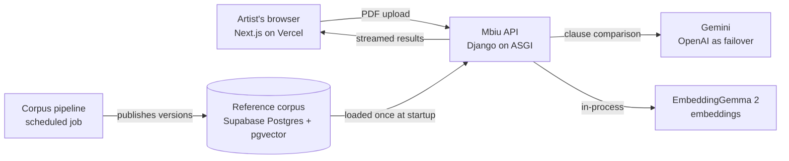

# Mbiu

**Understand a music contract before you sign it.**

Mbiu helps independent and early-career Kenyan musicians understand English-language music contracts. An artist uploads a PDF, and Mbiu compares every clause with reviewed standard contract templates. It then explains, in plain language, what each clause means for their **money**, their **music**, their **time** and their **freedom to take other work**, and what to ask the other party to change.

> **Mbiu is not legal advice.** It does not tell you whether to sign, and it does not judge whether a clause would hold up in court. It shows you how your contract compares with the standard, so you can ask better questions.

**Status:** early development. The setup commands below describe the intended workflow and come into use as each part of the project lands.

---

## Contents

- [Why Mbiu exists](#why-mbiu-exists)
- [What the artist experiences](#what-the-artist-experiences)
- [What Mbiu is not](#what-mbiu-is-not)
- [Privacy promise](#privacy-promise)
- [How it works](#how-it-works)
- [Tech stack](#tech-stack)
- [Repository layout](#repository-layout)
- [Getting started](#getting-started)
- [Everyday commands](#everyday-commands)
- [Configuration](#configuration)
- [Testing and quality](#testing-and-quality)
- [Deployment](#deployment)
- [Observability](#observability)
- [Licence](#licence)

---

## Why Mbiu exists

Artists regularly sign gig, brand, producer, distribution and recording deals they don't fully understand. In interviews, artists described:

- performing verbal gigs that were never paid;
- finding out about brand exclusivity only after signing;
- being unable to perform music they believed they could use.

Lawyers feel too expensive or too slow for small deals, so many artists sign without advice. Mbiu gives them a clear, honest first read in minutes.

## What the artist experiences

1. **Upload.** The artist reads a short privacy notice, confirms they may share the document, and uploads a text-based PDF from a phone or computer.
2. **See the contract.** Within seconds, the contract appears split into clauses while the checks run.
3. **Contract-wide issues first.** Clauses that contradict or override each other across pages are shown at the top.
4. **Result cards, most important first.** Money, ownership, term, exclusivity and termination come before boilerplate. Each card shows:
   - what the clause says and what it means for the artist;
   - how it compares with the standard, with numbers;
   - a worked example in shillings where money is involved;
   - fairer wording taken from the standard template;
   - one specific question to ask the other party.
5. **Summary.** The top three things to ask about, protections missing from the contract, good news, and an *ask list* that gathers every question into one message.
6. **Follow-up chat.** Questions answered from the contract and the templates only, with citations.
7. **Take it with you.** The artist downloads the full evaluation as a PDF report, or shares it to WhatsApp or email.

## What Mbiu is not

- Not a lawyer, a legal opinion or a negotiator.
- Never says "sign" or "don't sign".
- Does not decide whether a clause is enforceable.
- Does not generate contracts.

## Privacy promise

Contracts are sensitive. Mbiu is built so that **no contract is ever stored**:

- **Nothing kept on the server.** Uploaded PDFs are read in memory and never written to disk, a database, object storage, logs, traces, error reports or analytics. The server is stateless and forgets everything when the request ends.
- **Storage off at AI providers.** Every call to an AI provider is made on a paid tier with storage turned off. One module enforces this, and a test fails if any call leaves it out.
- **Nothing kept in the browser unless the artist asks.** Results stay in the open page. An opt-in switch can keep them in that browser tab for up to 60 minutes; it is off by default.
- **Canary-tested.** Automated tests push a synthetic contract containing a unique marker through the whole system, then check that the marker appears in no log, trace, error report, database row or file.
- **Only synthetic contracts in development.** Real contracts are never used in tests, fixtures or examples.

Every provider that receives contract text is listed in [`docs/data-transfers.md`](docs/data-transfers.md), in line with Kenya's Data Protection Act.

## How it works

### Architecture



- **Web app (Next.js):** privacy notice, upload, streamed result cards, summary, follow-up chat, PDF report.
- **API (Django + django-ninja):** validates the upload, extracts text, splits clauses, compares them and verifies each result, streaming results as they finish. It runs in one container and holds no state between requests.
- **Reference corpus (Supabase):** reviewed standard templates, Kenyan statutes and KECOBO guidance, with their sources and versions. It is loaded into memory at startup and is never on the request path.
- **Corpus pipeline:** an offline job that builds the corpus (see below).

### What happens when a contract is uploaded

1. **Check the upload.** Bot protection, file type, size, page count and encryption are checked before any AI call.
2. **Extract text** from the PDF in memory, in an isolated process with memory and time limits. Pages without text are reported, never silently dropped.
3. **Split into clauses**, keeping the exact wording, page numbers and position of each.
4. **Map the whole contract.** Cross-references ("clause 12", "Schedule B"), override wording ("notwithstanding", "subject to") and defined terms are linked, so clauses that affect each other are judged together.
5. **Order by impact.** Money, ownership, term, exclusivity and termination first; boilerplate last.
6. **Find evidence.** Hybrid search (vectors + keywords) finds the matching clauses in the reviewed templates.
7. **Compare** clauses in small batches, in parallel.
8. **Verify every result in code** before the artist sees it (see below).
9. **Check what's missing.** Protective clauses in the standard template that the contract lacks are reported.
10. **Summarise and forget.** The summary and ask list are sent, and everything held for the request is released.

Results stream to the browser one clause at a time, so the artist sees the first results within seconds even on long contracts.

### Comparison outcomes

| Outcome                   | Meaning                                                 |
| ------------------------- | ------------------------------------------------------- |
| `matches_standard`      | Same effect as the reviewed template                    |
| `better_for_you`        | More favourable to the artist than the standard         |
| `worse_for_you`         | Less favourable to the artist                           |
| `not_in_standard`       | The template has nothing like this clause               |
| `missing_from_contract` | A protection in the template that the contract lacks    |
| `cannot_compare`        | No matching template, or the result failed verification |

### Why the AI's answer is never shown as-is

The model's output is treated as a **proposal**. Code checks it against what was actually sent to the model:

- **Quotes:** every quote must be an exact match of the contract or template text.
- **IDs:** every clause and evidence ID must belong to this request.
- **Numbers:** every figure, percentage and duration must appear in the source text.
- **No legal conclusions:** words like "illegal", "unenforceable", "safe" or "you should sign" are blocked.
- **Plain language:** jargon must be explained on the same card.
- **Money:** both sides of a money comparison must say whether they are gross or net.

A result that fails gets one repair attempt. If it fails again, it becomes `cannot_compare`. **Mbiu never falls back to "matches the standard".**

### The corpus pipeline

The comparison is only as good as the templates behind it. The corpus pipeline is a scheduled job, built from the same container image as the API, that builds and versions that library:

1. **Fetch** public templates from the sources in [`corpus/sources.yaml`](corpus/sources.yaml) using Firecrawl.
2. **Store** each original file with its URL, fetch date, licence and reviewing body.
3. **Parse** PDF and DOCX files into headings, clauses and tables (Docling).
4. **Split** them with the same clause splitter used for artists' contracts.
5. **Tag** each clause with contract type, topic, jurisdiction and who it favours.
6. **Check automatically.** A source is published only if every check passes:
   - licence and source details are present;
   - it is a real template, not an article or a signed deal;
   - it contains no personal data;
   - it is in English;
   - near-duplicates are removed;
   - two independent models agree on every tag.
7. **Embed** each clause with EmbeddingGemma 2 and count how common each pattern is.
8. **Publish** a new numbered version. Published versions are never edited, and rolling back means pointing back to an earlier version.

The pipeline handles only public templates. It never sees an artist's contract.

## Tech stack

| Area            | Tools                                                                                                |
| --------------- | ---------------------------------------------------------------------------------------------------- |
| Backend         | Python, [uv](https://docs.astral.sh/uv/), Django (ASGI, uvicorn), django-ninja, Pydantic              |
| Documents       | PyMuPDF (live requests), Docling (corpus pipeline)                                                   |
| Search          | sentence-transformers with EmbeddingGemma 2, numpy, rank-bm25                                        |
| AI models       | Gemini (primary), OpenAI (failover only), tenacity, pybreaker                                        |
| Corpus pipeline | Firecrawl, Presidio, datasketch                                                                      |
| Data            | Supabase Postgres + pgvector, Supabase Storage, psycopg 3                                            |
| Frontend        | Next.js (App Router), TypeScript (strict), Zod, react-pdf, @react-pdf/renderer, Cloudflare Turnstile |
| Observability   | OpenTelemetry, Grafana Cloud, Jaeger (local), Sentry, PostHog, GrowthBook                            |
| Quality         | ruff, mypy, pytest, Hypothesis, promptfoo, ESLint, Vitest, Playwright, k6                            |
| Security        | gitleaks, Semgrep, Trivy, pip-audit, Dependabot                                                      |
| Delivery        | GitHub Actions, Docker, Cloud Run, Vercel                                                            |

## Repository layout

```
mbiu/
├── backend/            Django API and corpus pipeline (one container image)
│   ├── config/         settings, ASGI entry point, URLs
│   ├── mbiu/           one module per stage: api, documents, contract_map,
│   │                   retrieval, llm, evaluation, questions, corpus,
│   │                   pipeline, observability, security
│   └── tests/          unit, property, integration and privacy tests
├── frontend/           Next.js web app
│   └── src/            app routes, components, API client, PDF report
├── corpus/             sources.yaml: where the reference templates come from
├── evals/              synthetic contracts with planted risks, and quality tests
├── infra/              deployment definitions and Grafana dashboards as code
├── scripts/            type generation and local seed data
├── docs/               architecture, decision records (adr/), runbooks
├── docker-compose.yml  local Postgres + pgvector, PgBouncer, Jaeger, API
└── justfile            shortcuts for everyday commands
```

## Getting started

### 1. Install the tools

| Tool           | Windows (PowerShell)                                         | macOS                                                        |
| -------------- | ------------------------------------------------------------ | ------------------------------------------------------------ |
| Git            | `winget install Git.Git`                                   | `brew install git`                                         |
| Docker Desktop | [docker.com](https://www.docker.com/products/docker-desktop/) | [docker.com](https://www.docker.com/products/docker-desktop/) |
| Node.js 24 LTS | `winget install OpenJS.NodeJS.LTS`                         | `brew install node@24`                                     |
| pnpm           | `winget install pnpm.pnpm`                                 | `brew install pnpm`                                        |
| uv (Python)    | `winget install astral-sh.uv`                              | `brew install uv`                                          |
| just           | `winget install Casey.Just`                                | `brew install just`                                        |

After installing, open a new terminal so the tools are on your `PATH`.

**Docker memory:** in Docker Desktop, go to *Settings → Resources* and give it at least **6 GB** of memory. The embedding model needs room.

**Windows only:** clone into a short path such as `C:\dev\mbiu`. Windows has trouble with the long paths inside `node_modules`.

### 2. Clone and configure

```bash
git clone https://github.com/mutuiris/mbiu.git
cd mbiu
git switch develop
```

Copy the example environment file:

```bash
# macOS
cp .env.example .env
```

```powershell
# Windows
Copy-Item .env.example .env
```

`.env.example` lists every setting with a comment explaining it. Before the first run, fill in two values in `.env`:

- `DJANGO_SECRET_KEY`: generate one with `uv run python -c "import secrets; print(secrets.token_urlsafe(50))"`
- `POSTGRES_PASSWORD`: choose any local password (letters and digits), and put the same password in place of `PASSWORD` in `DATABASE_URL` and `DATABASE_DIRECT_URL`

Everything else works with its default, except features that call AI providers. **Never commit `.env`.** It is already in `.gitignore`.

### 3. Run it

Install the frontend dependencies once (and again whenever `frontend/package.json` changes):

```bash
just install
```

In one terminal, start the backend services (Postgres, PgBouncer, Jaeger and the API):

```bash
just dev
```

In a second terminal, start the frontend:

```bash
just web
```

### 4. Check that everything is running

| URL                           | What you should see                                   |
| ----------------------------- | ----------------------------------------------------- |
| http://localhost:3000         | The Mbiu web app                                      |
| http://localhost:8000/healthz | `{"status": "ok"}`: the API is alive                |
| http://localhost:8000/readyz  | Ready once the embedding model and corpus have loaded |
| http://localhost:16686        | Jaeger, showing a trace for each request              |

## Everyday commands

Run `just --list` to see every command. The common ones:

| Command            | What it does                                                        |
| ------------------ | ------------------------------------------------------------------- |
| `just install`   | Install frontend dependencies                                       |
| `just dev`       | Start Postgres, PgBouncer, Jaeger and the API                       |
| `just web`       | Start the frontend dev server                                       |
| `just test`      | Run backend tests                                                   |
| `just lint`      | Lint and format-check backend and frontend                          |
| `just typecheck` | mypy for the backend, `tsc` for the frontend                      |
| `just down`      | Stop all local services                                             |
| `just reset`     | Stop local services and delete the local database                   |

`just` is only a shortcut. Each recipe in the `justfile` is a plain `docker`, `uv` or `pnpm` command that you can also run directly.

## Configuration

All configuration comes from **environment variables**. The settings are validated at startup, and the app refuses to start if anything required is missing.

| Group              | Examples                                                                                                    |
| ------------------ | ----------------------------------------------------------------------------------------------------------- |
| Django             | `DJANGO_SECRET_KEY`, `DJANGO_ALLOWED_HOSTS`                                                             |
| Database           | `DATABASE_URL` (pooled), `DATABASE_DIRECT_URL` (migrations and pipeline)                                |
| AI models          | `GEMINI_API_KEY`, `GEMINI_MODEL_MAIN`, `GEMINI_MODEL_LIGHT`, `OPENAI_API_KEY`, `FAILOVER_ENABLED` |
| Embeddings         | `EMBEDDING_MODEL_ID`, `EMBEDDING_REVISION`, `EMBEDDING_DIM`                                           |
| Limits and budgets | `MAX_UPLOAD_MB`, `MAX_PAGES`, `BATCH_SIZE`, `LLM_CONCURRENCY`, `TOKEN_BUDGET_PER_CONTRACT`        |
| Security           | `TURNSTILE_SECRET_KEY`, `CORS_ALLOWED_ORIGINS`                                                          |
| Telemetry          | `OTEL_EXPORTER_OTLP_ENDPOINT`, `SENTRY_DSN`                                                             |
| Frontend (public)  | `NEXT_PUBLIC_API_URL`, `NEXT_PUBLIC_TURNSTILE_SITE_KEY`                                                 |

Only variables starting with `NEXT_PUBLIC_` reach the browser. Secrets never go into the frontend bundle. See [`.env.example`](.env.example) for the full, commented list.

## Testing and quality

| Kind                    | What it covers                                                                                                                                                                                                |
| ----------------------- | ------------------------------------------------------------------------------------------------------------------------------------------------------------------------------------------------------------- |
| Unit and property tests | Clause splitting, verification rules, impact ordering. Property tests use Hypothesis to check, for example, that clauses never overlap.                                                                       |
| Integration tests       | The API with a real local Postgres.                                                                                                                                                                           |
| Privacy (canary) tests  | A unique marker in a synthetic contract must never appear in logs, traces, errors, database rows or files.                                                                                                    |
| Failure injection       | Fake AI providers that are slow, rate-limited, return invalid JSON or invent numbers. Each must produce the expected fallback.                                                                                |
| Evaluations             | Synthetic contracts with deliberately planted risks and conflicts. **Quality gate:** no planted risky clause may come out as `matches_standard` without a flag. This gate blocks merges and releases. |
| Frontend                | Vitest for logic, Playwright for full user flows.                                                                                                                                                             |
| Load                    | k6 tests at the maximum page count, including slow-AI and failover scenarios.                                                                                                                                 |

All test contracts are **synthetic**, generated by [`evals/generator/`](evals/generator/). Real contracts are never used anywhere in this repository.

## Deployment

| Part            | Where                                                   | Deployed from                                                        |
| --------------- | ------------------------------------------------------- | -------------------------------------------------------------------- |
| API             | Container on Cloud Run (portable to any container host) | `develop` → staging, `prod` → production                       |
| Corpus pipeline | Same container image, run as a scheduled job            | Manual or scheduled                                                  |
| Frontend        | Vercel                                                  | Feature branches and `develop` → previews; `prod` → production |

- **No stored cloud keys.** Deployments authenticate with OIDC; no long-lived cloud keys are kept in GitHub.
- **Secrets per environment.** Each environment (`staging`, `production`) has its own secrets.
- **Portable.** Cloud-specific files live only in [`infra/deploy/`](infra/deploy/), and the application code does not depend on any one cloud provider.

## Observability

Mbiu uses **OpenTelemetry** for traces, metrics and logs, sent to any OTLP endpoint:

- **Locally:** Jaeger, at http://localhost:16686.
- **In production:** Grafana Cloud (Tempo, Prometheus, Loki), with dashboards and alerts kept as code in [`infra/grafana/`](infra/grafana/).

Telemetry carries **counts, IDs, durations and versions only**, never contract text, clause text, prompts or model responses. A test fails if any span attribute could hold content.
