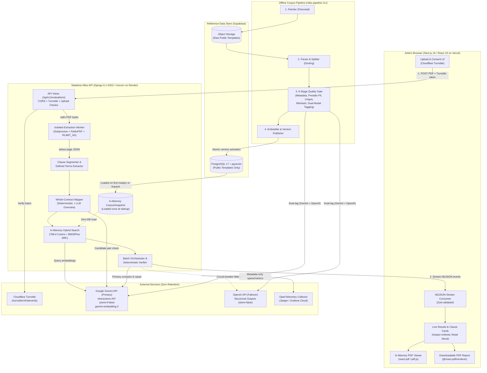
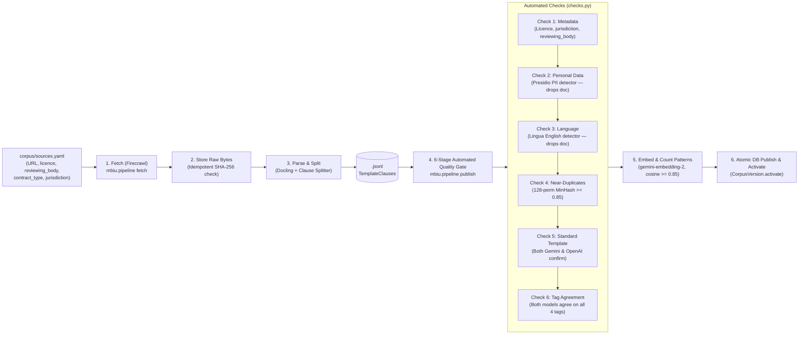
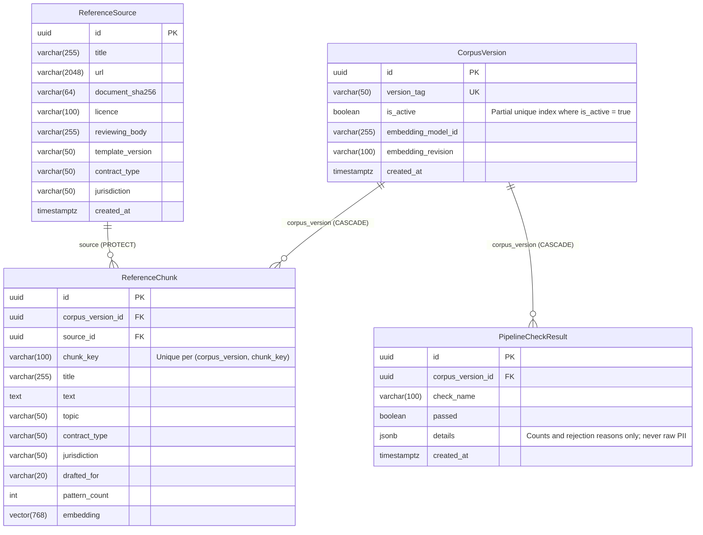

# Mbiu System Architecture

**Mbiu** (*"Understand a music contract before you sign it"*) is a stateless, zero-storage contract evaluation system designed to help independent and early-career Kenyan musicians understand English-language music contracts. Artists upload a contract PDF and Mbiu compares each clause against a curated, versioned corpus of standard reference templates, statutes, and guidance (such as WIPO and Kenya Copyright Board templates), streaming plain-language explanations and specific negotiation questions back to the browser in real time.

> [!IMPORTANT]
> **Non-Negotiable System Invariants**
> 1. **Not Legal Advice:** Mbiu never renders legal opinions, never judges whether a clause is lawful or enforceable, never drafts substitute contract language (restricted under Kenya's Advocates Act), and never tells an artist whether to sign.
> 2. **Zero Contract Storage:** Uploaded PDFs, extracted clause text, prompts, and model outputs are processed strictly in memory and are never persisted to disk, databases, object stores, logs, traces, or analytics.
> 3. **Model Output is a Proposal:** Every AI output is treated as an untrusted proposal that must pass deterministic code verification (exact quote matching, number grounding, reading grade, anti-jargon, and no-legal-conclusions checks) before reaching the user.

---

## Table of Contents

1. [High-Level System Topology](#1-high-level-system-topology)
2. [Core Architectural Principles & Invariants](#2-core-architectural-principles--invariants)
3. [Repository Structure](#3-repository-structure)
4. [Live Evaluation Pipeline (Request Lifecycle)](#4-live-evaluation-pipeline-request-lifecycle)
5. [Backend Architecture (`backend/`)](#5-backend-architecture-backend)
   - [5.1 API Layer & Streaming Protocol (`mbiu.api`)](#51-api-layer--streaming-protocol-mbiuapi)
   - [5.2 Document Validation, Subprocess Extraction & Segmentation (`mbiu.documents`)](#52-document-validation-subprocess-extraction--segmentation-mbiudocuments)
   - [5.3 Whole-Contract Mapping & Conflict Detection (`mbiu.contract_map`)](#53-whole-contract-mapping--conflict-detection-mbiucontract_map)
   - [5.4 In-Memory Corpus & Hybrid Retrieval (`mbiu.corpus`, `mbiu.retrieval`)](#54-in-memory-corpus--hybrid-retrieval-mbiucorpus-mbiuretrieval)
   - [5.5 AI Provider Adapters, Failover & Circuit Breakers (`mbiu.llm`)](#55-ai-provider-adapters-failover--circuit-breakers-mbiullm)
   - [5.6 Deterministic Verification Engine (`mbiu.evaluation.verify`)](#56-deterministic-verification-engine-mbiuevaluationverify)
   - [5.7 Evaluation Orchestrator (`mbiu.evaluation.orchestrator`)](#57-evaluation-orchestrator-mbiuevaluationorchestrator)
6. [Offline Corpus Pipeline (`mbiu.pipeline`)](#6-offline-corpus-pipeline-mbiupipeline)
7. [Data Architecture & Database Schema](#7-data-architecture--database-schema)
8. [Frontend Architecture (`frontend/`)](#8-frontend-architecture-frontend)
   - [8.1 Next.js Application & Routing](#81-nextjs-application--routing)
   - [8.2 Type-Safe Contract & NDJSON Stream Consumer](#82-type-safe-contract--ndjson-stream-consumer)
   - [8.3 Impact Ordering, Neutral Labels & Result Cards](#83-impact-ordering-neutral-labels--result-cards)
   - [8.4 Client-Side Privacy & Opt-In Tab Retention](#84-client-side-privacy--opt-in-tab-retention)
   - [8.5 Printable PDF Report Generator](#85-printable-pdf-report-generator)
9. [Security, Privacy & Compliance Architecture](#9-security-privacy--compliance-architecture)
10. [Quality Gates, Testing & Evaluation Suite (`evals/`)](#10-quality-gates-testing--evaluation-suite-evals)
11. [Observability, Deployment & Operations (`infra/`, `docs/runbooks/`)](#11-observability-deployment--operations-infra-docsrunbooks)

---

## 1. High-Level System Topology

Mbiu separates its **online, stateless evaluation path** from its **offline corpus ingestion pipeline**. The database is never queried on the critical path of a user's contract evaluation once the active corpus snapshot has been loaded into process memory.



---

## 2. Core Architectural Principles & Invariants

| Principle | Architectural Enforcement |
| :--- | :--- |
| **Stateless & Zero Storage** | The backend uses no session middleware, no user accounts, no file-upload disk handlers, and no database tables for user contracts. A database guard test (`backend/tests/test_database_guard.py`) and privacy canary test (`backend/tests/test_privacy_canary.py`) assert that no user contract marker ever reaches logs, spans, disk, or Postgres. |
| **Provider Storage Off** | All LLM calls are routed exclusively through `backend/mbiu/llm/`. Both `Gemini` (`store=False` via the Interactions API) and `OpenAI` (`"store": False` via Chat Completions) hardcode zero-retention flags on every request. |
| **Prompt-Injection Defense** | Contract clauses, template excerpts, and repair payloads are wrapped in XML-style delimited blocks via `as_data(tag, text, ...)` (`backend/mbiu/llm/__init__.py`), which escapes any closing tags inside untrusted contract text and instructs the model to treat enclosed content strictly as data. |
| **Deterministic Verification Gate** | AI responses are parsed into `ClauseComparisonProposal` and checked against 9 deterministic rules in `backend/mbiu/evaluation/verify.py`. Failed proposals receive at most **1 repair attempt**; a second failure forces `Outcome.CANNOT_COMPARE` and discards all model-generated prose. |
| **Grounded Financial Inputs** | The LLM never invents financial figures. Instead, the model extracts verbatim `ImpactInputs` (royalty rate, gross/net basis, deductions) verified against the source text, which the frontend uses (`src/lib/impact.ts`) to prioritize high-impact financial clauses. |
| **No Green Labels** | Because a "typical" music industry clause can still carry heavy consequences (e.g., long exclusivity or recoupment), Mbiu uses four neutral tones (`🔵 Typical`, `🟡 Unusual`, `🟠 Worth inquiry`, `⚪ Couldn't compare`) and never uses green or "safe" badges. |

---

## 3. Repository Structure

```text
mbiu/
├── backend/                        # Python 3.14 / Django 6.1 ASGI service & corpus pipeline
│   ├── config/                     #Typed Pydantic settings, URL routing, ASGI + OTel setup
│   ├── mbiu/
│   │   ├── api/                    # Pydantic v2 API contract schemas, OpenAPI exporter, streaming views
│   │   ├── contract_map/           # Whole-contract link extraction, classifier & conflict analyzer
│   │   ├── corpus/                 # Django ORM models (4 tables), in-memory snapshot loader, synthetic corpus
│   │   ├── documents/              # In-memory PDF validation, isolated subprocess extractor, clause segmenter
│   │   ├── evaluation/             # Stream orchestrator and 9-rule deterministic verifier
│   │   ├── llm/                    # Gemini & OpenAI adapters, circuit breakers, versioned markdown prompts
│   │   ├── pipeline/               # Offline CLI pipeline: fetch, store, parse, split, check, tag, embed, publish
│   │   ├── retrieval/              # Gemini embedder, hybrid RRF search (vectors + BM25Plus), topic ranking
│   │   ├── security/               # Cloudflare Turnstile verification & SanitizedLogFilter
│   │   ├── health.py               # /healthz (liveness) and /readyz (readiness: DB + corpus + embedding model)
│   │   └── observability.py        # Custom privacy-preserving ASGI TracingMiddleware & OTLP exporter
│   └── tests/                      # Unit, property (Hypothesis), integration, failover, and canary tests
├── frontend/                       # Next.js 16 (App Router), React 19, TypeScript 6 (strict)
│   └── src/
│       ├── app/                    # Routes: /, /results, /privacy, /terms, /team
│       ├── components/             # Upload dropzone, Turnstile, LiveResults, ClauseCard, ContractViewer, ReportDocument
│       └── lib/                    # Generated OpenAPI types/Zod schemas, NDJSON stream client, impact/outcome helpers
├── corpus/                         # Public reference template configuration & local standards artifacts
│   ├── sources.yaml                # Reviewed public template manifests (WIPO, KECOBO)
│   ├── standards_and_statutes/     # Kenyan & international music standards documentation
│   └── system_annotated_contracts/ # Synthetic annotated contracts & fine-tuning/context datasets
├── evals/                          # Quality gates, golden dataset generator, and retrieval benchmarks
│   ├── datasets/                   # Golden set JSONL, manifest, schemas, expected sidecars, synthetic PDFs
│   ├── generator/                  # Synthetic contract generator, reference evaluator, and strict quality gate
│   ├── retrieval/                  # Retrieval evaluation runner and benchmark dataset
│   └── sample_contracts/           # Sample synthetic contracts (Markdown & generated PDFs)
├── infra/                          # Operational infrastructure & load testing
│   ├── deploy/                     # Cloud deployment descriptors
│   ├── grafana/                    # Dashboards and alerts as code
│   └── k6/                         # k6 load test suite & 40-page synthetic PDF generator
├── scripts/                        # Local developer utilities (e.g., seed_local_corpus.py)
├── docs/                           # Architecture docs, data transfer registry, corpus research, 2 a.m. runbooks
├── docker-compose.yml              # Local dev stack: Postgres 17 + pgvector, PgBouncer, Jaeger, API
└── justfile                        # Task runner recipes for development, testing, linting, and codegen
```

---

## 4. Live Evaluation Pipeline (Request Lifecycle)

When an artist uploads a PDF to `POST /api/v1/evaluations`, the request progresses through 10 deterministic and AI-assisted stages while streaming newline-delimited JSON (`application/x-ndjson`) back to the browser:

```mermaid
sequenceDiagram
    autonumber
    actor Artist
    participant FE as Next.js Frontend
    participant API as Mbiu API (Views & Orchestrator)
    participant Worker as Extraction Subprocess
    participant Search as Hybrid Retriever (In-Memory)
    participant LLM as Gemini / OpenAI (store=False)
    participant Verifier as Code Verifier (verify.py)

    Artist->>FE: Select PDF, accept privacy notice, pass Turnstile
    FE->>API: POST /api/v1/evaluations (multipart PDF + turnstile_token + traceparent)
    API->>API: Validate Turnstile token & validate_upload() (magic bytes, <=10MB, <=40 pages, unencrypted)
    API-->>FE: HTTP 200 OK (application/x-ndjson stream opened)

    API->>Worker: Spawn subprocess with RLIMIT_AS (512MB) & adaptive timeout; pipe PDF via stdin
    Worker-->>API: Return page texts, character offsets & skipped_pages via stdout
    API->>API: segment_document() -> Clauses, Sections, DefinedTerms
    API-->>FE: Stream DocumentEvent (page_count, sections, clauses, skipped_pages)

    API->>API: Deterministic link extraction (cross-refs, overrides, defined terms, same-topic pairs)
    API->>LLM: Analyze top candidate pairs for conflicts/overrides (15s cap)
    LLM-->>API: IssueProposals
    API->>API: Verify issue quotes are verbatim substrings & merge with deterministic rules
    API-->>FE: Stream ContractMapEvent (contract_type, links, issues)

    API->>LLM: Batch embed all clauses + topic examples (gemini-embedding-2, 768-d)
    API->>Search: Classify clause topics & run Hybrid RRF Search (Cosine + BM25Plus, KE boosted)
    API->>API: Sort clauses by IMPACT_RANK (Royalties/Money first -> Boilerplate last)
    API-->>FE: Stream ProgressEvent (stage="compare", done=0, total=N)

    loop For each batch (BATCH_SIZE=6, concurrency=4, within deadline & 400k token budget)
        par Parallel clauses in batch
            API->>LLM: Compare clause vs template evidence (structured JSON)
            LLM-->>API: ClauseComparisonProposal
            API->>Verifier: Run 9 verification rules (quotes, IDs, numbers, grade, jargon, basis)
            alt Verification failed (1st time)
                API->>LLM: One repair call with specific rule failure reasons
                LLM-->>API: Repaired ClauseComparisonProposal
                API->>Verifier: Re-verify all 9 rules
            end
            Verifier-->>API: Verified ClauseResult (or fallback to CANNOT_COMPARE)
        end
        API-->>FE: Stream ClauseResultEvent + ProgressEvent per completed clause
    end

    API->>Search: Check missing_protections (accounting_audit, termination, payment)
    API-->>FE: Stream DoneEvent (Summary: top_asks, contract_issues, missing_protections, good_news, ask_list, versions)
    Note over API: Request ends; all in-memory PDF bytes, clauses, and results are garbage-collected
```

### Partial Retries & Resume (`POST /api/v1/clause-evaluations`)
If individual clauses fail due to transient provider rate limits or timeouts, or if the contract hits its time/token budget before checking lower-priority clauses, the browser already holds the segmented `Clause` objects in memory. Clicking **"Retry"** or **"Check the other N"** sends only those specific `Clause` objects plus a fresh Turnstile token to `POST /api/v1/clause-evaluations`, which skips PDF extraction and contract mapping and streams back `progress`, `clause_result`, and `clause_failed` events.

---

## 5. Backend Architecture (`backend/`)

The backend is a Python 3.14 application built on **Django 6.1** running under **Uvicorn (ASGI)**. It uses Django strictly for HTTP routing, security middleware, and ORM access to the read-only reference corpus.

### 5.1 API Layer & Streaming Protocol (`mbiu.api`)

- **Single Source of Truth (`backend/mbiu/api/schemas.py`):** All request payloads, error codes, and stream events are defined as frozen Pydantic v2 models inheriting from `Contract` (`extra="forbid"`, `frozen=True`, `json_schema_serialization_defaults_required=True`).
- **Schema Codegen (`backend/mbiu/api/openapi.py`):** Running `just types` exports the Pydantic models to `frontend/src/lib/api/openapi.json` and runs `@hey-api/openapi-ts` to generate TypeScript types (`types.gen.ts`) and runtime Zod validators (`zod.gen.ts`).
- **Endpoints (`backend/config/urls.py`):**
  - `GET /healthz`: Liveness probe (`{"status": "ok"}`), checks no dependencies.
  - `GET /readyz`: Readiness probe, verifies database connectivity, loads the active corpus snapshot into memory on first call, and verifies `snapshot.embedding_model_id == settings.EMBEDDING_MODEL_ID`.
  - `POST /api/v1/evaluations`: Accepts multipart PDF upload + Turnstile token; returns `application/x-ndjson` stream or pre-stream JSON `ApiError` (`400`/`503`).
  - `POST /api/v1/clause-evaluations`: Accepts JSON `ClauseEvaluationRequest` for retrying or finishing specific clauses; returns `application/x-ndjson` stream.
- **Stream Events (`SCHEMA_VERSION = "1"`):** Discriminated union on `type`:
  - `document` (`DocumentEvent`)
  - `contract_map` (`ContractMapEvent`)
  - `progress` (`ProgressEvent`)
  - `clause_result` (`ClauseResultEvent`)
  - `clause_updated` (`ClauseUpdatedEvent`)
  - `clause_failed` (`ClauseFailedEvent`)
  - `heartbeat` (`HeartbeatEvent` — emitted every 10 seconds when the worker queue is quiet to prevent reverse-proxy idle timeouts)
  - `done` (`DoneEvent`)

### 5.2 Document Validation, Subprocess Extraction & Segmentation (`mbiu.documents`)

1. **In-Memory Upload Validation (`upload.py`):**
   - Validates non-empty payload, file size ceiling (`MAX_UPLOAD_MB = 10`), and `%PDF-` magic bytes.
   - Opens the byte stream in memory via `pymupdf.open(stream=data, filetype="pdf")` to reject encrypted/password-protected PDFs (`EncryptedPDFError`), zero-page documents (`EmptyPDFError`), and documents exceeding `MAX_PAGES = 40` (`PageLimitExceededError`).
2. **Isolated Subprocess Extraction (`extract.py`, `extractor_worker.py`):**
   - PDF parsing in C/C++ libraries can be vulnerable to malformed-font memory bombs or infinite loops. Mbiu spawns `python -m mbiu.documents.extractor_worker` as a separate OS process.
   - The worker applies POSIX address-space limits (`resource.RLIMIT_AS` set to `512 MB`) and checks RSS via `psutil` before each page.
   - Raw PDF bytes are piped over `stdin` and structured page JSON is returned over `stdout`—zero temporary files touch the filesystem.
   - An adaptive timeout scales with page count: `EXTRACTION_TIMEOUT_S (30.0s) + page_count * EXTRACTION_TIMEOUT_PER_PAGE_S (0.5s)`.
   - Pages without an extractable text layer are recorded in `skipped_pages`. If *all* pages lack text, `ScannedPDFError` is raised with a plain-language message explaining that Mbiu requires text-based PDFs.
3. **Clause Segmentation & Defined Terms (`segment.py`):**
   - `segment_document()` classifies lines into structural sections (`Preamble`, `Recitals`, `main`, `Schedule X`, `Annex Y`, `Signatures`) and hierarchical clauses (`1`, `1.1`, `1.1(a)`, `(i)`, standalone headings).
   - Preserves the exact invariant `full_text[clause.start_offset:clause.end_offset] == clause.text` and tracks every 1-indexed page spanned by each clause.
   - Extracts explicit definitions (`"Net Receipts" means...`) and inline parenthetical definitions (`...(the "Term")`) into a `DefinedTerm` map with clause and offset provenance.

### 5.3 Whole-Contract Mapping & Conflict Detection (`mbiu.contract_map`)

Contracts frequently hide critical modifications in cross-references or schedules (e.g., Clause 3 sets a 1-year term, while Clause 14 says *"Notwithstanding Clause 3, the Term shall be 5 years"*). `map_contract()` analyzes the segmented document in four steps:

1. **Contract Type Classification (`classifier.py`):** Scores preamble, titles, and body text against regex patterns for `recording`, `publishing`, `management`, `distribution`, and `live_performance`.
2. **Deterministic Link Extraction (`deterministic.py`):** Extracts `ClauseLink` edges without an LLM:
   - `override`: Targeted override phrases (`notwithstanding clause X`, `subject to section Y`, `prevails over clause Z`) plus general override occurrences (`notwithstanding anything to the contrary`).
   - `cross_reference`: Explicit references (`clause 7.2`, `Schedule A`, `Annex 1`).
   - `defined_term`: Links any clause using a non-generic defined term back to the clause where that term is defined.
3. **Linear Candidate Pair Nomination (`candidates.py`):** Pairs all deterministically linked clauses and clusters clauses touching the same functional topic (`term_renewal`, `royalties_payment`, `rights_ownership`, `exclusivity`, `termination`) within a bounded window (`min(len(cluster), i + 6)`), keeping complexity $O(N)$ rather than $O(N^2)$.
4. **Hybrid Conflict & Override Analyzer (`rules.py`, `analyzer.py`):**
   - **Deterministic Baseline (`rules.py`):** Detects duration/term clashes across linked or same-topic clauses and targeted overrides, extracting verbatim sentence quotes.
   - **Verified LLM Overview (`analyzer.py`):** Sends up to 10 candidate pairs (wrapped in `<contract_clause>` data tags) to Gemini using `prompts/contract_map_v1.md` with a capped 15-second deadline. Every returned `IssueProposal` is verified by `verify_issue_quotes()` to ensure both quotes are exact verbatim substrings of the respective clauses before merging with deterministic issues.

### 5.4 In-Memory Corpus & Hybrid Retrieval (`mbiu.corpus`, `mbiu.retrieval`)

- **Startup Snapshot Caching (`corpus/loader.py`, `corpus/snapshot.py`):**
  - `active_snapshot()` queries the active `CorpusVersion` and its `ReferenceChunk` rows once, assembling a frozen `CorpusSnapshot` in memory containing a `(N, 768)` `float32` NumPy matrix of unit-normalized embeddings and a tuple of `SnapshotChunk` metadata.
  - Subsequent requests read directly from `_snapshot` in memory with zero database queries.
  - In local development when no corpus version is published in Postgres, retrieval transparently falls back to `SYNTHETIC_CORPUS` (`corpus/synthetic.py`), which provides 8 hand-crafted templates derived from WIPO, the Kenya Copyright Act (Cap. 130), and KECOBO guidance.
- **Single-Call Batch Embedding (`retrieval/embed.py`):**
  - `GeminiEmbedder` calls `gemini-embedding-2` with `output_dimensionality=768` in batches of up to 100 texts, L2-normalizing all returned vectors and verifying finiteness.
- **Topic Classification & Impact Ordering (`retrieval/topics.py`):**
  - Classifies each clause into one of 15 topics by cosine similarity against embedded `TOPIC_EXAMPLES`.
  - Assigns an `IMPACT_RANK` (0 to 7) so the orchestrator evaluates and streams high-impact clauses first:
    - **Rank 0:** `royalties`, `payment`, `advances_recoupment`, `accounting_audit`
    - **Rank 1:** `grant_of_rights`, `moral_rights`
    - **Rank 2:** `term`
    - **Rank 3:** `exclusivity`
    - **Rank 4:** `termination`
    - **Rank 5:** `warranties_indemnities`, `credit`, `dispute_resolution` (and unclassified clauses)
    - **Rank 6:** `definitions`
    - **Rank 7:** `governing_law`, `boilerplate`
- **Hybrid Reciprocal Rank Fusion Search (`retrieval/search.py`):**
  - Filters candidate chunks to the detected `contract_type` (falling back to all chunks if none match).
  - Computes lexical scores via an in-memory `BM25Plus` index (chosen over Okapi BM25 so terms appearing in $\ge 50\%$ of a small corpus do not receive zero weight) and semantic scores via matrix-vector dot product (`snapshot.embeddings @ query_vector`).
  - Fuses rankings using Reciprocal Rank Fusion ($K = 60$):
    $$\text{score}(d) = \frac{1}{60 + \text{rank}_{\text{BM25}}(d)} + \frac{1}{60 + \text{rank}_{\text{cosine}}(d)}$$
  - Shortlists the top $2k$ candidates and sorts Kenyan jurisdiction chunks (`jurisdiction == "KE"`) ahead of international ones.
- **Disagreement & Missing Protection Checks (`retrieval/evidence.py`):**
  - `disagreement()` inspects the top 2 retrieved templates; if both templates and the artist's clause specify a figure with the same unit (`%`, `days`, `months`, `years`) and the two templates disagree, a neutral context note is attached to the card.
  - `missing_protections()` checks whether the contract's classified topics cover core standard protections (`accounting_audit`, `termination`, `payment`); any missing topic surfaces a `MissingProtection` item in the final summary with a pre-reviewed question to ask.

### 5.5 AI Provider Adapters, Failover & Circuit Breakers (`mbiu.llm`)

All model interactions are encapsulated in `backend/mbiu/llm/`:

- **Primary Provider — Google Gemini (`llm/gemini.py`):**
  - Uses the Google GenAI SDK `client.aio.interactions.create` endpoint with `store=False`, structured JSON schema output (`response_format={"mime_type": "application/json", "schema": schema}`), `temperature=0.1`, and configurable `GEMINI_THINKING_LEVEL` (default `"low"`).
  - Default models: `gemini-3.8-flash` (main) and `gemini-3.5-flash-lite` (light/cost-control fallback).
- **Secondary Failover Provider — OpenAI (`llm/openai.py`):**
  - Uses `httpx.AsyncClient` against `https://api.openai.com/v1/chat/completions` with `"store": False` and Structured Outputs strict mode (`to_strict_json_schema()` transforms Pydantic JSON schemas by setting `additionalProperties: false`, listing all properties in `required`, and stripping defaults).
  - Default model: `gpt-4o-mini`.
- **Resilience Controls:**
  - **Deadline-Aware Retries (`tenacity`):** At most `MAX_ATTEMPTS = 2` per call, retrying only on `RATE_LIMITED`, `TIMEOUT`, or `UNAVAILABLE` (5xx). Custom `_StopNearDeadline` and `_WaitWithinDeadline` strategies honor `Retry-After` headers while guaranteeing no retry ever sleeps or starts within 1 second of the contract's monotonic deadline.
  - **Circuit Breakers (`pybreaker`):** Each provider instance maintains a circuit breaker (`fail_max=5`, `reset_timeout=60s`) that counts only outage-class errors (`TIMEOUT`, `RATE_LIMITED`, `UNAVAILABLE`, 401/403/5xx) and ignores schema validation or content refusals.
  - **Batch-Level Failover (`orchestrator.py`):** When `FAILOVER_ENABLED=True` and either Gemini's circuit breaker is `open` or any clause in the current batch fails with `UNAVAILABLE`/`TIMEOUT`, the entire batch fails over cleanly to OpenAI using `prompts/compare_openai_v1.md`.

### 5.6 Deterministic Verification Engine (`mbiu.evaluation.verify`)

Every `ClauseComparisonProposal` returned by Gemini or OpenAI is checked against 9 deterministic verification rules in `verify.py`:

| Rule Name | What It Verifies |
| :--- | :--- |
| `quotes_are_exact` | `clause_quote` must be a non-empty, character-for-character substring of `sent.clause_text`. If `evidence_quote` is present, it must be an exact substring of the cited `Evidence.excerpt`. |
| `ids_are_real` | `clause_id` must match the sent clause ID, and `evidence_id` (if non-null) must belong to the `Evidence` list sent for that clause. |
| `numbers_are_grounded` | Every numeric figure (digits or number words followed by duration/percentage units) appearing in `headline`, `what_it_says`, `what_it_means`, or `ask_them` must appear in the source clause text, clause ID, or template excerpts. |
| `no_legal_conclusions` | Blocks prohibited words/phrases (`illegal`, `unlawful`, `unenforceable`, `enforceable`, `legally binding`, `void`, `against the law`, `safe`, `unsafe`, `guaranteed`, `risk-free`, `you should sign`, `do not sign`, etc.) unless the word appears verbatim in the source text. |
| `plain_language` | Computes the **Flesch-Kincaid Grade Level** of `what_it_says + what_it_means` and rejects proposals exceeding `MAX_READING_GRADE` (default `9.0`). Also checks 11 legal jargon patterns (`net receipts`, `recoup*`, `in perpetuity`, `cross-collateraliz*`, `indemn*`, `moral rights`, `mechanical royalt*`, `neighbouring rights`, `synchronization`, `force majeure`, `right of first refusal`) and requires an inline explanation immediately following any jargon term. |
| `fits_a_phone` | Enforces strict character caps for mobile readability: `headline <= 80`, `what_it_says <= 280`, `what_it_means <= 280`, `ask_them <= 160`. |
| `usable_question` | If `ask_them` is provided, it must end with `?`, contain at least 5 words, and not match vague question patterns (`can you explain...`, `what does this mean...`, `is this fair/normal/legal...`). |
| `money_is_comparable` | If both the contract clause and the template excerpt mention a percentage share of money/royalties/receipts, both must explicitly state `gross` or `net` before the model is allowed to return `matches_standard`, `better_for_you`, or `worse_for_you`. Otherwise, it must return `cannot_compare`. |
| `impact_inputs_grounded` | If `impact_inputs` is populated, every `royalty_rate_percent`, `money_basis`, and `deductions` item must carry a verbatim `quote` substring from `sent.clause_text`, and the numeric rate / basis must match the wording inside its quote. |

**One-Repair-Then-Fallback Policy:**
If `verify()` returns any failed rules, `orchestrator._evaluate_single_clause()` makes **one repair call** to the LLM containing the previous JSON answer and the exact rule failure reasons. If the repaired response still fails any rule, the model's prose is completely discarded and the clause is emitted with `status=ClauseStatus.CANNOT_COMPARE`, `comparison=Outcome.CANNOT_COMPARE`, and a fixed safe message. Every rule failure increments the OpenTelemetry counter `mbiu.verify.failures{rule=...}`.

### 5.7 Evaluation Orchestrator (`mbiu.evaluation.orchestrator`)

`orchestrator.py` coordinates the end-to-end evaluation stream:
- Runs synchronous CPU/IO tasks (`validate_upload`, `extract_text_from_pdf`, `segment_document`, `active_snapshot`) via `asyncio.to_thread()` so the ASGI event loop and 10-second `HeartbeatEvent` task never stall.
- Enforces two per-contract resource budgets:
  - **Wall-Clock Deadline:** `min(DEADLINE_CAP_S (300s), 10.0 + clause_count * DEADLINE_PER_CLAUSE_S (3.0s))`.
  - **Token Budget:** `_TokenBudget(TOKEN_BUDGET_PER_CONTRACT = 400,000)` tracked across all primary and repair LLM calls.
- Evaluates clauses in impact-sorted batches of `BATCH_SIZE = 6` with an `asyncio.Semaphore(LLM_CONCURRENCY = 4)`. If either budget is exhausted between batches, remaining lower-impact clauses are emitted as `ClauseFailedEvent(reason=FailureReason.NOT_CHECKED, retryable=True)` so the user still receives a complete `DoneEvent` summary and can check the rest on demand.

---

## 6. Offline Corpus Pipeline (`mbiu.pipeline`)

The reference corpus is built and updated offline via the CLI (`python -m mbiu.pipeline fetch` and `python -m mbiu.pipeline publish`), packaged in the same Docker image as the API (with optional dependency group `uv sync --group pipeline`). It processes only public templates listed in `corpus/sources.yaml` and never touches artist contracts.



### Pipeline Stages in Detail
1. **Fetch & Store (`fetch.py`, `store.py`, `pipeline.py`):** Reads `corpus/sources.yaml`, fetches documents via Firecrawl, computes the SHA-256 digest of the original file, and stores it idempotently in object storage with provenance metadata. Already-stored SHA-256 digests are skipped on re-runs.
2. **Parse & Split (`parse.py`, `split.py`):** Parses PDF/DOCX layout into structured markdown/sections using **Docling**, splits them into `TemplateClause` records, and writes `<sha256>.jsonl` files.
3. **Six-Stage Automated Quality Gate (`checks.py`, `tag.py`):** Because no human manually edits chunks in the database, every document and clause must pass six automated checks before publication:
   - **Document Check 1 — Metadata (`check_metadata`):** Drops the entire document if `licence`, `jurisdiction`, or `reviewing_body` is missing.
   - **Document Check 2 — Personal Data (`check_personal_data`):** Strips template placeholders (`[___]`, `<...>`, `____`) and scans with **Microsoft Presidio** (`en_core_web_lg` spaCy model) for `PERSON`, `EMAIL_ADDRESS`, `PHONE_NUMBER`, `CREDIT_CARD`, `IBAN_CODE`, `IP_ADDRESS`, and `CRYPTO`. If any entity is found, the entire document is dropped (preventing populated/signed deals from entering the corpus). Only entity type names are logged—never the matched PII text.
   - **Document Check 3 — English Language (`check_english`):** Uses **Lingua** to verify the document is in English; otherwise drops the entire document.
   - **Clause Check 4 — Near-Duplicate Removal (`check_near_duplicates`):** Computes 128-permutation 3-word shingle **MinHash** signatures using BLAKE2b and drops any clause with $\ge 0.85$ similarity to an earlier kept clause.
   - **Clause Check 5 — Standard Template Confirmation (`check_standard_template`):** Tags every kept clause independently with **two distinct models** (Gemini and OpenAI) using `prompts/corpus_tag_v1.md`. Drops any clause where either model sets `is_standard_template = False` (filtering out articles, explanatory prose, or marketing pages).
   - **Clause Check 6 — Dual-Model Tag Agreement (`check_tag_agreement`):** Keeps a clause only if both Gemini and OpenAI independently agree on all four tags: `contract_type`, `topic`, `jurisdiction`, and `drafted_for` (`label`, `artist`, or `neutral`).
4. **Embed, Pattern Count & Atomic Publish (`embed.py`, `publish.py`):**
   - Embeds all passing clauses with `gemini-embedding-2` (768 dimensions).
   - Computes `pattern_count` for each chunk (how many chunks in the version have cosine similarity $\ge 0.85$ with it).
   - Writes `CorpusVersion`, `ReferenceSource`, `ReferenceChunk`, and `PipelineCheckResult` rows inside a single atomic database transaction and calls `CorpusVersion.activate(version_tag)`.

---

## 7. Data Architecture & Database Schema

Mbiu's PostgreSQL 17 (`pgvector`) database contains **only four application tables**, defined in `backend/mbiu/corpus/models.py`. No table exists—or may ever be added—for user contracts, evaluation sessions, or user data.



### Database Connection Pooling & Versioning Rules
- **Single Active Version Constraint:** `corpus_versions` enforces a conditional unique constraint `UniqueConstraint(fields=["is_active"], condition=Q(is_active=True), name="one_active_corpus_version")`. Published versions are immutable; rolling back is a single transactional swap via `CorpusVersion.activate(previous_tag)`.
- **Transaction-Mode Pooling (`settings.py`):** The API connects through **PgBouncer** (locally on port `6432`) or **Supabase Supavisor** (in cloud environments on port `6543`) with `"CONN_MAX_AGE": 0`, `"DISABLE_SERVER_SIDE_CURSORS": True`, and `"OPTIONS": {"prepare_threshold": None}`. Direct connections (`DATABASE_DIRECT_URL` on port `5432`) are used exclusively by one-off `migrate` and `pipeline` jobs.

---

## 8. Frontend Architecture (`frontend/`)

The web client is a **Next.js 16** (App Router) and **React 19** application written in strict TypeScript (`typescript@6`), styled with **Tailwind CSS v4**, and deployed on **Vercel**.

### 8.1 Next.js Application & Routing
- `/` (`src/app/page.tsx`): Landing experience with the privacy notice (`PrivacyNotice.tsx`), explicit consent checkbox, client-side PDF pre-validation (`FileDropzone.tsx`, `src/lib/validation.ts`), Cloudflare Turnstile widget (`Turnstile.tsx`), and transition into the evaluation view.
- `/results` (`src/app/results/page.tsx`): Dedicated evaluation results view that consumes the active stream or restores an in-memory/tab-kept session.
- `/privacy`, `/terms`, `/team`: Static informational routes detailing data transfers, legal disclaimers, and team information.
- `EvaluationFloatingBanner.tsx`: A global banner rendered across routes when an evaluation is actively streaming or held in memory so the artist can navigate to `/privacy` or `/team` and return to their results without losing state.

### 8.2 Type-Safe Contract & NDJSON Stream Consumer
- **Generated Schema Validation (`src/lib/api/generated/`):** Every incoming line on the `ReadableStream` is parsed as JSON and validated at runtime by `zStreamEvent.safeParse()` (`src/lib/api/stream.ts`). Heartbeat events are silently consumed to keep the connection alive, while invalid JSON or schema mismatches raise typed `StreamParseError` or `StreamValidationError` exceptions.
- **Distributed Tracing Propagation:** `generateTraceparent()` generates a W3C `traceparent` header (`00-<traceId>-<spanId>-01`) using `crypto.getRandomValues()` so frontend requests correlate directly with backend OpenTelemetry traces.

### 8.3 Impact Ordering, Neutral Labels & Result Cards
- **Neutral Outcome Mapping (`src/lib/outcome.ts`):**
  - `matches_standard`, `better_for_you` $\rightarrow$ `🔵 Typical`
  - `not_in_standard` $\rightarrow$ `🟡 Unusual`
  - `worse_for_you`, `missing_from_contract` $\rightarrow$ `🟠 Worth inquiry`
  - `cannot_compare` $\rightarrow$ `⚪ Couldn't compare`
- **High-Impact Focus & Collapsed Boilerplate (`src/lib/impact.ts`, `src/lib/report.ts`):**
  - `isHighImpactClause()` surfaces clauses involving contract-wide conflicts/overrides, material deviations, verified monetary `ImpactInputs` (`hasClearFormula()` or deductions), or high-impact topics (royalties, advances, recoupment, copyright/masters, exclusivity, term, termination, indemnity) as full write-up cards (`ClauseCard.tsx`), sorted by `getImpactRank()`.
  - Standard boilerplate clauses (`matches_standard` clauses covering notices, governing law, counterparts, etc.) are cleanly collapsed into a compact summary fold so artists are not overwhelmed on mobile screens.
- **Mobile-First Result Cards & Accessibility (`src/components/results/ClauseCard.tsx`):**
  - Uses progressive disclosure (`Fold` components for *"In simple words"*, *"Why it matters"* on mobile, and *"See the exact words"* comparing the contract quote with usual standard wording).
  - Provides one-tap **Copy** and **Share on WhatsApp** (`https://wa.me/?text=...`) actions for negotiation questions (`ask_them`), cross-clause navigation pills, and a Kenyan English (`en-KE`) Web Speech API `ReadAloudButton`.
- **In-Memory PDF Clause Highlighting (`src/components/viewer/ContractViewer.tsx`, `src/lib/highlight.ts`):**
  - Renders the artist's local `File` object in the browser via `react-pdf` (`ssr: false`) and highlights the exact clause text on its target pages when the artist clicks **"View on page X"**.

### 8.4 Client-Side Privacy & Opt-In Tab Retention (`src/lib/keep-tab.ts`)
- By default, evaluation results live only in JavaScript memory (`activeMemorySession`) and vanish as soon as the tab is reloaded or closed.
- An opt-in toggle (`KeepResultsSwitch.tsx`) lets the artist keep the event log in `window.sessionStorage` (`mbiu:kept-results`) for **up to 60 minutes** (`KEEP_FOR_MS = 3,600,000`) within that browser tab only. Expired or invalid payloads are automatically purged, and clicking **"Clear now"** or uploading another contract immediately calls `forgetResults()`.

### 8.5 Printable PDF Report Generator (`src/components/report-pdf/`)
- Built with `@react-pdf/renderer` (`ReportDocument.tsx`, `download.ts`), generating a downloadable A4 PDF client-side in the browser without contacting the server.
- Styled in high-contrast black-and-white (`Times-Roman`, `10.5pt–18pt`) for inexpensive printing at cybercafés, containing:
  1. Report metadata and educational non-legal-advice notice
  2. Neutral label legend (`How to Read This Report`)
  3. Evaluation summary & top questions to ask
  4. Clauses that clash (conflicts & overrides with verbatim quotes)
  5. Clause-by-clause write-ups with verbatim quotes and cited standard sources
  6. Missing standard protections (`Missing from your contract`)
  7. Numbered negotiation checklist (`[  ] 1. ...`) for meetings with labels, managers, or lawyers

---

## 9. Security, Privacy & Compliance Architecture

Mbiu is engineered around **Privacy by Design** and compliance with **Kenya's Data Protection Act (2019)** and **Advocates Act**:

1. **Log Scrubbing (`backend/mbiu/security/logging.py`):**
   - `SanitizedLogFilter` inspects every `logging.LogRecord` (message, `%` args, `extra` dict, exception tracebacks, and `stack_info`) before any handler formats it.
   - Redacts values under 43 sensitive key names (`clause_text`, `contract_text`, `pdf_bytes`, `prompt`, `quote`, `email`, `artist_name`, `token`, etc. $\rightarrow$ `[REDACTED]`).
   - Scrubs email addresses (`[REDACTED_EMAIL]`), phone numbers (`[REDACTED_PHONE]`), quoted spans $\ge 8$ chars containing spaces (`[REDACTED_CONTRACT_TEXT]`), and any unbroken line $\ge 120$ characters (`[REDACTED_CONTRACT_TEXT]`).
   - **Fails closed:** If sanitization raises an unexpected exception on any record, all non-reserved attributes are stripped and the message is replaced with `[REDACTED_LOG_RECORD]`.
2. **Privacy-Safe OpenTelemetry Middleware (`backend/mbiu/observability.py`):**
   - Replaces standard OpenTelemetry ASGI auto-instrumentation (which leaks client IPs, user agents, and query strings) with a minimal `TracingMiddleware` that records only `http.request.method` and `http.response.status_code`, and skips `/healthz` and `/readyz`.
   - Internal spans (`mbiu.upload`, `mbiu.extract`, `mbiu.segment`, `mbiu.map_contract`, `mbiu.retrieve`, `mbiu.compare`, `mbiu.verify`, `llm.call`) record only counts, stage names, model versions, token counts, and verification rule names—never text content.
3. **Bot & Cost Protection (`backend/mbiu/security/turnstile.py`):**
   - Every `POST /api/v1/evaluations` and `POST /api/v1/clause-evaluations` call validates a single-use Cloudflare Turnstile token against `https://challenges.cloudflare.com/turnstile/v0/siteverify` before running PDF extraction or AI calls.
   - Supports deterministic Cloudflare test keys (`1x0000...0AA` pass, `2x0000...0AA` fail) for offline local development and CI tests.
4. **Cross-Border Data Transfer Transparency (`docs/data-transfers.md`):**
   - Documents every external processor that receives contract text (Google Gemini API and, when failover is enabled, OpenAI API), their paid-tier zero-retention settings (`store=False`), and confirms that Supabase, Vercel, Grafana Cloud, Sentry, PostHog, and Cloudflare Turnstile never receive contract text.

---

## 10. Quality Gates, Testing & Evaluation Suite (`evals/`)

All contracts in the repository are **100% synthetic**. Real artist contracts are never used in tests, fixtures, or evaluations.

### 10.1 Automated Test Suite (`backend/tests/`, `frontend/src/`)
- **Database Guard (`test_database_guard.py`):** Inspects registered Django models and migrations to ensure only the 4 public corpus tables exist and no table can store user contracts.
- **Privacy Canary (`test_privacy_canary.py`):** Runs a synthetic contract embedded with unique canary strings through the full pipeline and asserts that the canary strings never appear in captured logs, OpenTelemetry spans, error payloads, the filesystem, or the database.
- **Property-Based Tests (`test_segment.py`, `test_verify.py`):** Uses **Hypothesis** to verify invariants such as non-overlapping clause character offsets (`full_text[start:end] == clause.text`) and deterministic verifier rejection of ungrounded numbers or legal conclusions.
- **Failure Injection & Failover (`test_openai_failover.py`, `test_evaluation_stream.py`):** Injects simulated timeouts, HTTP 429s, circuit-breaker trips, and malformed JSON responses to verify seamless batch failover to OpenAI and graceful fallback to `cannot_compare`.
- **Frontend Unit & E2E Tests:** **Vitest** suites (`*.test.ts`, `*.test.tsx`) test stream parsing, Zod validation, impact ranking, clause card rendering, and `sessionStorage` expiry; **Playwright** (`frontend/playwright.config.ts`) covers end-to-end browser flows.

### 10.2 Golden-Set Quality Gate (`evals/`)
- **Synthetic Contract & Planted Risk Generator (`evals/generator/`):** Generates realistic music contracts (`evals/datasets/golden_set.jsonl` and `evals/datasets/pdfs/`) with deliberately planted clause risks (e.g., perpetual rights assignment, post-term exclusivity, hidden royalty deductions, missing payment dates) and cross-clause conflicts (`expected/*.expected.json`).
- **100%-Strict Merge Gate (`evals/generator/gate.py`, `tests/test_golden_set_eval.py`):**
  - Run via `python -m evals.generator.gate` or **Promptfoo** (`evals/promptfooconfig.yaml`).
  - **Gate Invariant:** *No planted risky clause may ever be classified as `matches_standard` without a risk flag, and no planted cross-clause conflict may be missed.* Any violation exits non-zero and blocks CI/release.
- **Retrieval Benchmark (`evals/retrieval/run.py`):** Evaluates top-$k$ recall and reciprocal rank of the hybrid RRF retriever against `evals/retrieval/dataset.json`.

---

## 11. Observability, Deployment & Operations (`infra/`, `docs/runbooks/`)

### 11.1 Local Development & Container Topology (`docker-compose.yml`)
Running `just dev` spins up four local containers:
1. `postgres`: `pgvector/pgvector:0.8.7-pg17-bookworm` on `127.0.0.1:5432` (direct connection for `just migrate` and `mbiu.pipeline`).
2. `pgbouncer`: `edoburu/pgbouncer:v1.26.0-p0` in `transaction` pool mode (`MAX_PREPARED_STATEMENTS=0`) on `127.0.0.1:6432` (pooled connection for `api`).
3. `jaeger`: `jaegertracing/jaeger:2.22.0` exposing the trace UI on `http://localhost:16686` and OTLP HTTP receiver on port `4318`.
4. `api`: Built from `backend/Dockerfile` (`python:3.14-slim-bookworm`, non-root user `mbiu` UID `10001`), running `uvicorn config.asgi:application --reload` on `http://localhost:8000`.

### 11.2 Production Deployment & Load Testing
- **API & Pipeline Image (`backend/Dockerfile`):** Single multi-purpose container image deployed to **Render** (`develop` $\rightarrow$ staging, `prod` $\rightarrow$ production). The same image runs on a schedule for the corpus pipeline.
- **Frontend:** Deployed on **Vercel** with preview environments per pull request and `develop` branch.
- **Load Testing (`infra/k6/`):** `k6_evaluations_load.js` and `generate_40p_contract.py` stress-test `POST /api/v1/evaluations` up to the 40-page ceiling under concurrent load, slow-provider simulation, and failover scenarios.

### 11.3 Operational Runbooks (`docs/runbooks/`)
2 a.m. incident playbooks are maintained alongside the codebase and tested via `backend/tests/test_runbooks_and_load.py`:
- [`docs/runbooks/provider-outage.md`](runbooks/provider-outage.md): Triaging Gemini/OpenAI outages and toggling `FAILOVER_ENABLED=true` or `GEMINI_MODEL_MAIN=gemini-3.5-flash-lite`.
- [`docs/runbooks/cost-spike.md`](runbooks/cost-spike.md): Mitigating token burn spikes via Flash-Lite switch, lowering `TOKEN_BUDGET_PER_CONTRACT` / `MAX_PAGES`, and tightening Cloudflare Turnstile WAF rate limits.
- [`docs/runbooks/supabase-paused.md`](runbooks/supabase-paused.md): Recovering from a paused Supabase project or saturated Supavisor connection pooler (port `6543` vs `5432`) and falling back to local Postgres + `scripts/seed_local_corpus.py`.
- [`docs/runbooks/corpus-rollback.md`](runbooks/corpus-rollback.md): Rolling back a degraded corpus version in `corpus_versions` via transactional `is_active` pointer swap and restarting the API.
