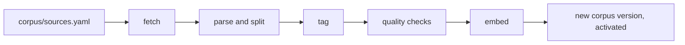

# The reference corpus

Mbiu compares each contract clause with reference text: standard contract templates, statutes and guidance from bodies such as the Kenya Copyright Board (KECOBO) and WIPO. That reference text is the corpus. It decides what Mbiu can call **Typical**: a contract type the corpus doesn't cover gets almost no Typical results.

The rules behind it are in [decision 0006](adr/0006-reference-corpus-from-licensed-sources.md).

## How it gets built



The corpus pipeline (`backend/mbiu/pipeline/`) runs as a GitHub Actions workflow, [`corpus-pipeline.yml`](../.github/workflows/corpus-pipeline.yml):

1. **Fetch** every source in `corpus/sources.yaml`, respecting robots.txt strictly: a site that disallows it, or whose robots.txt can't be read, is skipped.
2. **Parse and split** each document into clauses. Only PDF and DOCX files can be parsed.
3. **Tag** each clause with its contract type and topic. Two different models must agree.
4. **Check** every clause: required metadata, no personal data, English text, no near-duplicates, reads like a standard template, tags agree. Clauses that fail are left out and the reason is recorded.
5. **Embed** the clauses with `gemini-embedding-2`, the same model the API uses for contract clauses.
6. **Publish** a new corpus version and make it the active one.

The API loads the active version into memory when it starts, so a new version reaches artists after the next API restart (a deploy, or Render waking from sleep).

## Adding a source

Add an entry to [`corpus/sources.yaml`](../corpus/sources.yaml). Every field is required:

```yaml
- url: https://copyright.go.ke/sites/default/files/downloads/RECORDING-PRODUCER%20AGREEMENT.pdf
  licence: CC BY-SA
  reviewing_body: Kenya Copyright Board (KECOBO)
  contract_type: recording
  jurisdiction: KE
```

| Field | Rule |
|---|---|
| `url` | A **direct link to a PDF or DOCX file** that opens without logging in. Web pages are crawled into HTML, which the parser can't read, so the run fails. |
| `licence` | The licence that lets Mbiu reuse the text, as the publisher states it (for example `CC BY 4.0`). Unclear or "public" isn't enough: confirm it before adding. |
| `reviewing_body` | Who wrote or reviewed the document |
| `contract_type` | One of `recording`, `publishing`, `management`, `distribution`, `live_performance`, `producer`, `licensing`, `assignment`, `brand` |
| `jurisdiction` | `KE` for Kenyan sources, otherwise the country or `international`. Kenyan sources are preferred when matching. |

Before opening the pull request:

- [ ] The link opens and returns the file: `curl -sIL "<url>" | grep -i "^HTTP\|content-type"` shows `200` and a PDF or Word content type.
- [ ] The licence allows reuse, and you've noted any doubt in a comment above the entry, as the KECOBO entries do.
- [ ] It's a real standard, template, statute or official guidance, not a blog post, a sample made up for Mbiu, or a contract between real people.
- [ ] Add sources one at a time, so a bad one is easy to find. **One source that fails to fetch or parse stops the whole run**, and no new version is published.

Gaps worth filling: there are no sources yet for `brand`, `live_performance`, `distribution`, `producer` and `publishing` contracts.

## Running the pipeline

- **When:** every Monday at 03:00 UTC, and by hand from the Actions tab (**Corpus pipeline → Run workflow**).
- **Switched on by** the repository variable `CORPUS_PIPELINE_ENABLED=true`.
- **Secrets**, in the GitHub environment `corpus`: `DATABASE_DIRECT_URL` (the Supabase session pooler, port 5432), `TURNSTILE_SECRET_KEY`, `GEMINI_API_KEY`, `FIRECRAWL_API_KEY`, `STORAGE_S3_ENDPOINT`, `STORAGE_S3_KEY`, `STORAGE_S3_SECRET`; optional `OPENAI_API_KEY`. Variables: `STORAGE_BUCKET`, `STORAGE_S3_REGION`. An empty secret can fail the run at the settings check.

To run it locally against a local database, with the pipeline extras installed:

```bash
cd backend
uv sync --group pipeline
uv run python -m mbiu.pipeline fetch
uv run python -m mbiu.pipeline publish
```

## Checking which version is live

In the Supabase SQL editor:

```sql
select version_tag, is_active, created_at
from corpus_versions
order by created_at desc;
```

The final summary of every check also records it, in `versions.corpus`. To go back to an earlier version, follow [the rollback runbook](runbooks/corpus-rollback.md).

## Never

- **Never run the backend tests against a shared database.** Test fixtures create and activate their own corpus. On 8 November 2026 this replaced the production corpus with two fake recording clauses. The tests now refuse any database that isn't local, so keep `DATABASE_URL` pointing at the local Postgres when you run them.
- **Never add the built-in synthetic templates** (`backend/mbiu/corpus/synthetic.py`) or made-up "standards" to the corpus. They exist for tests and outages, and must not claim to be official.
- **Never put real artists' contracts in the corpus or the repo.** Use the synthetic samples in `evals/`.
